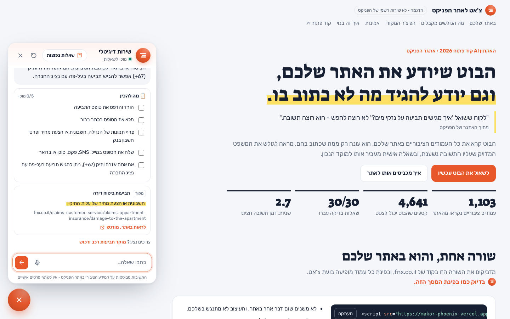

# Phoenix Site Assistant — a RAG chatbot that answers only from the website

A Hebrew-first customer-service chatbot for the website of The Phoenix (fnx.co.il), an Israeli insurance and finance company. It answers visitors' questions **only from the content of the public website**, shows the exact source sentence for every answer, says plainly when something is not on the site, and routes personal questions to the right service center.

Built for the **Open Code AI Hackathon 2026** (The Phoenix challenge). Not an official Phoenix service.

**[Live demo](https://makor-phoenix.vercel.app)** · **[1-minute video](https://makor-phoenix.vercel.app/media/demo.mp4)** · **[Content-gap report](https://makor-phoenix.vercel.app/insights.html)**



---

## What it does

- **Answers only from the site.** No general knowledge, no guessing. If the answer isn't on fnx.co.il, the bot says so and points to the relevant service center.
- **A source for every answer.** Each source card shows the page address and the exact sentence the answer relies on. Clicking it opens the real Phoenix page with that sentence already highlighted (browser Text Fragments).
- **Knows its limits.** Questions about the user's own policy or claim get general information from the site plus the matching service center (phone, WhatsApp, hours, and whether it is open right now) — never a "yes/no" about a personal policy.
- **Follow-up questions.** "And how long until I get an answer?" is answered from the same page as the previous answer.
- **Multilingual.** Ask in Hebrew, Russian, Arabic or English and get the answer in that language; the quoted source stays in Hebrew so it can be verified.
- **Richer answers when they help.** A comparison table for "what's the difference between…" questions, and a "what to prepare" checklist for claim questions.
- **Voice.** Ask by speaking (speech-to-text fills the input) and listen to the answer (text-to-speech).
- **Original feature — content-gap report.** Every on-topic question that has no answer on the site is logged (numbers and emails masked, no personal data), grouped by site area, and shown to the content team: a ready-made list of what visitors look for and don't find. Gibberish and off-topic questions are filtered out.
- **Drop-in widget.** One `<script>` tag adds the chat bubble to any page, without changing the host site.

## How it works

```
 Build time (once)                                   Request time (every question)
 ─────────────────                                   ─────────────────────────────
 sitemap.xml                                         question (+ previous turn)
   │  polite crawler: 1,103 public pages               │
   ▼                                                    ▼
 clean + split by headings: 4,641 chunks              hybrid retrieval: semantic (e5) + keyword (BM25), RRF fusion
   │                                                    │  → 6 distinct chunks (follow-ups start from the previous page)
   ▼                                                    ▼
 multilingual-e5 embeddings (Chroma)                  LLM (Gemini / Groq chain) → strict JSON
   │                                                    │
   ▼                                                    ▼
 chunks + vectors shipped to the server               guardrails in code → answer + sources + service center
                                                        │
                                                        └─ no answer on the site → content-gap report
```

**Guardrails are enforced in code, not only in the prompt:**

| Rule | How it is enforced |
|---|---|
| Only the site is a source | The model sees only the 6 retrieved chunks. An "answered" result with no source is turned into "not found". Questions with no lexical or semantic match never reach the model. |
| No invented links | The model returns a chunk *number*; the code builds the link from the chunk's stored URL. |
| Real quotes | The quoted sentence must appear verbatim in the chunk and support the answer's main point; otherwise a matching line from the page is used instead. |
| No personal advice | Personal questions are detected by the model and by a second check in code; they get a fixed opening that refers to customer service, with no "yes/no" and no promises. |
| Prompt injection | The user's text is delimited and treated as data, never as instructions or sources. |

**Resilience on free-tier APIs:** a chain of 13 models (Gemini, Gemma, and Groq-hosted open models, optionally on two Gemini keys). If a model is slower than 3 seconds, the next one starts in parallel and the first valid answer wins; failures fall through instantly; daily quotas are detected and skipped; retries use exponential backoff within a 40-second budget. Repeated questions are served from a 3-day cache.

## Tech stack

| Area | Tools |
|---|---|
| Crawling & processing | Python, requests, BeautifulSoup |
| Embeddings & retrieval | multilingual-e5-base (sentence-transformers for indexing, ONNX Runtime for queries), BM25 (rank-bm25), Reciprocal Rank Fusion, Chroma, NumPy |
| LLMs | Google Gemini / Gemma API, Groq (gpt-oss, Qwen) — REST, JSON-schema output |
| Backend | Flask on Vercel (serverless) |
| Storage | Upstash Redis (content-gap report, answer cache) |
| Frontend | Vanilla JavaScript and CSS (no framework), Web Speech API, Text Fragments |
| Quality | 30-question evaluation suite, simulated failure tests for the model chain |

## Evaluation

30 hand-written questions modeled on the site's FAQ and claims pages, graded strictly (correct facts, a source from the right site area, and correct refusals):

| Type | Questions | Result |
|---|---|---|
| Answer exists on the site | 18 | 18/18 |
| Not on the site (must not invent) | 6 | 6/6 |
| Boundaries (personal, advice, jailbreak) | 4 | 4/4 |
| Follow-up questions | 2 | 2/2 |

Retrieval alone finds the needed facts for 19/19 answerable questions. Full results: [`eval/web_results.json`](eval/web_results.json) and on the [live page](https://makor-phoenix.vercel.app/#trust).

Edge cases tested: model rate limits and outages (429/503), a crawler blocked by the site (exponential backoff, no WAF bypass), duplicate content, prompt injection, gibberish, and HTML injection in answers (all output is escaped).

## Run locally

```bash
cd web
pip install -r requirements.txt
# keys in ../.env: GEMINI_API_KEY, GROQ_API_KEY (optional: GEMINI_API_KEY_2, KV_REST_API_URL, KV_REST_API_TOKEN)
python app.py                      # http://localhost:8000
python eval_web.py full            # run the 30-question evaluation
python tests/test_llm_chain.py     # model-chain failure tests (no API calls)
```

Rebuilding the data from the live site: `collect_pages.py` → `chunk_pages.py` → `build_index.py` (repo root), then `web/build_data.py`. The crawl resumes where it stopped and the index updates only changed chunks.

## Project structure

```
collect_pages.py, chunk_pages.py, build_index.py   build pipeline (crawl → chunks → vectors)
web/app.py                                         Flask server: /api/ask, /api/insights
web/lib/retrieval.py                               hybrid search and fusion
web/lib/bot.py                                     prompt, guardrails, quote verification, routing
web/lib/llm.py                                     model chain, hedged requests, backoff
web/lib/insights.py, web/lib/cache.py              content-gap report, answer cache
web/public/                                        widget, landing page, report page
eval/                                              questions and results
app.py, rag.py                                     the first Streamlit prototype
```

## Limitations

- PDFs (policies, forms) and a few JavaScript-only listing pages are not included.
- Free-tier model quotas: when the fastest models are exhausted, answers are slower (10–20 s) until the daily reset.
- Hebrew keyword search uses simple prefix stripping, not a full morphological analyzer.
- Content is a snapshot from 20.10.2026; refreshing means re-running the build pipeline.

---

The Phoenix name and website content belong to The Phoenix. This is an independent hackathon project.
